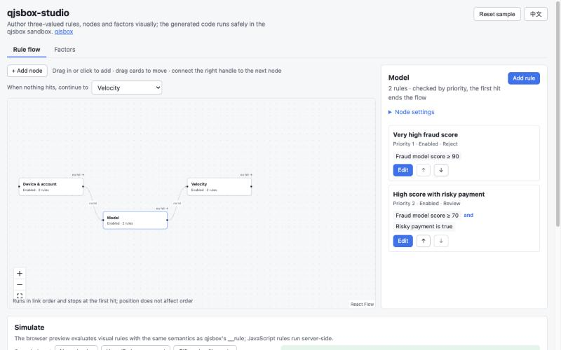
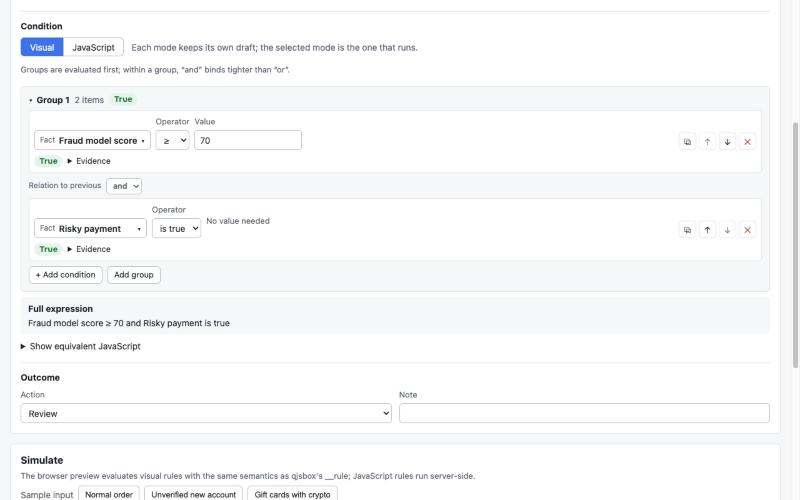

# qjsbox-studio

[中文说明](README.zh-CN.md)

React components for authoring rules that run in the [qjsbox](https://github.com/Huozhewande/qjsbox) sandbox: a visual condition builder that switches to JavaScript, a rule-flow canvas with node editing, and factor management.



qjsbox runs untrusted JavaScript rules safely on the server. qjsbox-studio is the authoring side: operators build conditions visually, and the studio generates the closed `__rule` helper code that qjsbox analyzes and executes. Conditions are **three-valued**: a missing or failed fact is *unavailable*, never silently `false`, and a flow stops instead of passing when it cannot decide.



## What's inside

| Piece | What it does |
|-|-|
| `ConditionBuilder` | Nested condition groups with typed values per fact kind, copy / reorder / delete, per-item and/or links (“and” binds tighter than “or”), a natural-language summary, and per-condition evidence. |
| `RuleConditionEditor` | One-click switch between the visual builder and JavaScript. Each mode keeps its own draft; the first switch to JavaScript starts from the generated code. |
| `RuleFlowCanvas` | React Flow canvas for a single execution chain: drag to place, connect a node's “no hit” output to the next node. Links are validated (one start, one predecessor, no cycles). |
| `RuleStudio` | Canvas plus the selected node's rules (priority order, reorder, enable, delete) and a focused rule editor with a fact picker and your own outcome editor. |
| `FactPicker` / `FactPickerDialog` | Searchable fact table with category, type and source filters; unavailable facts stay visible with their reason. |
| `FactorManager` | Reusable factors defined visually or in JavaScript, with identifiers referenced as `factors.<identifier>`. Referenced factors lock their identifier and type and cannot be deleted. |
| `generateRuleCode` | Turns a condition into `__rule.all/any/test` code for qjsbox. |
| `evaluateFlow` / `evaluateExpression` | In-browser preview with the same semantics as qjsbox's `__rule` helper, returning evidence for every condition. |
| `flowEdits`, `validateFlow` | Pure functions to add, link, reorder and remove nodes and rules. |

The UI ships in Chinese and English, follows the system light/dark theme, and is restyled through `--qs-*` CSS variables.

## Try the demo

```sh
npm install
npm run dev        # http://127.0.0.1:5179
```

The demo is a checkout-risk flow with three nodes, six rules and three factors, plus a simulation panel with sample inputs.

## Use it

Not on npm yet. Build it from source with `npm run build`, which writes `dist/`.

```tsx
import { RuleStudio, StudioProvider, evaluateFlow, type Fact, type RuleFlow } from "qjsbox-studio";
import "qjsbox-studio/styles.css";

const facts: Fact[] = [
  { key: "order.amount", label: "Order amount", kind: "NUMBER", category: "Order" },
  { key: "user.verified", label: "Verified", kind: "BOOLEAN", category: "User" },
  { key: "user.country", label: "Country", kind: "ENUM", options: [{ value: "US" }, { value: "DE" }] },
];

type Outcome = "PASS" | "REVIEW" | "REJECT";

function Editor({ flow, setFlow }: { flow: RuleFlow<Outcome>; setFlow: (flow: RuleFlow<Outcome>) => void }) {
  const preview = evaluateFlow(flow, { "order.amount": 2400, "user.verified": false }, { facts });
  return <StudioProvider locale="en">
    <RuleStudio value={flow} onChange={setFlow} facts={facts} defaultOutcome="REVIEW" evidence={preview.evidence}
      renderOutcome={({ value, onChange, disabled }) =>
        <select value={value} disabled={disabled} onChange={(e) => onChange(e.target.value as Outcome)}>
          <option>PASS</option><option>REVIEW</option><option>REJECT</option>
        </select>} />
  </StudioProvider>;
}
```

The flow is plain, serializable data (`RuleFlow` → `FlowNode` → `Rule`), so you store and version it however you like.

### Running rules on the server

Each rule compiles to qjsbox input. The resolver supplies fact values by key and computes factors:

```ts
import { conditionSource } from "qjsbox-studio";
const code = conditionSource(rule.condition); // generated __rule code, or the rule's JavaScript
```

```go
analysis, _ := runner.Analyze(ctx, "RULE", code)
result, err := runner.Execute(ctx, qjsbox.Request{
	Kind: "RULE", Code: code, Input: input, Now: now, AllowedReferences: analysis.References,
}, resolveFact)
// err with Code SCRIPT_FACTOR_UNAVAILABLE means the condition was unavailable: fail closed.
```

Walk the chain like `evaluateFlow` does: enabled nodes in link order, enabled rules by priority, stop at the first hit, and stop without passing when a rule is unavailable. For facts with options, return them as `AvailableOptions` so rules that still use a removed option become unavailable on both sides.

The preview and qjsbox agree: the repository's test suite covers the semantics, and the generated code for the demo flow was checked against qjsbox v0.1.1 with matching results on every sample.

## Concepts

- **Fact**: something a condition can test, with a key, a kind (`BOOLEAN`, `NUMBER`, `TEXT`, `ENUM`, `SET`), optional options and a category.
- **Factor**: a reusable, named computation over facts. A visual factor returns a boolean; a JavaScript factor returns a boolean, number or text. Factors cannot use other factors.
- **Rule**: a condition (visual or JavaScript) plus an opaque outcome you define.
- **Node**: an ordered list of rules. When none hits, evaluation continues to the node's `next`.
- **Flow**: one chain of nodes. Canvas positions never change the execution order.

## Customizing

- `StudioProvider` takes `locale` (`"zh-CN"` or `"en"`) and `messages` to override any string, for example to call rules “policies”.
- Override `--qs-accent`, `--qs-radius`, `--qs-font` and the other `--qs-*` variables, or set `data-qs-theme="dark"` / `"light"` on `<html>` to force a theme.
- `renderOutcome` and `describeOutcome` define what a rule does when it hits.
- `FactorManager` accepts `testFactor` to run factor tests on your server through qjsbox; without it, visual factors are tested in the browser.

## Status

Pre-1.0. The model and component props may still change. Not included: persistence, draft and release workflows, permissions, and server-side execution, which belong to your application and to qjsbox.

## Development

```sh
npm test           # Vitest + Testing Library
npm run typecheck
npm run build      # library to dist/
npm run build:demo # static demo to demo/dist/
```

## License

Apache License 2.0. See [LICENSE](LICENSE) and [NOTICE](NOTICE). The bundled stylesheet includes React Flow's base styles (MIT); see [THIRD_PARTY_NOTICES.md](THIRD_PARTY_NOTICES.md).
